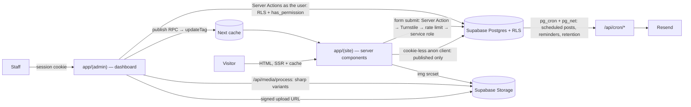

# The Light City Church — Website + Admin CMS
## Final Architecture & Build Plan (v2, after senior review)

This is the source of truth for rebuilding thelightcitychurch.org as a CMS-driven Next.js site with an admin dashboard. It adapts the "Hueride admin + CMS" brief to a church, keeps the current Antigravity public design, and uses Supabase for the database, auth and storage.

Claude Code: read this file before every task, work only on the current phase, and keep `supabase/tests/rls_test.sql` passing.

---

## 0. Key decisions

| # | Decision | Why |
|---|---|---|
| D1 | **Next.js 16 App Router, server-rendered public site**, with two separate root layouts: `(site)` and `(admin)` | Fast SEO pages. The admin's Tailwind styles never load on the public site |
| D2 | **Supabase (Postgres + Auth + Storage), Pro plan, London region** | Free projects pause after 7 days (downtime), and backups/PITR need Pro. UK church → UK data residency |
| D3 | **Security lives in the database**: RLS on every table, permission checks inside functions, invariants as constraints and triggers | One forgotten check in app code can't leak data. Tests prove it |
| D4 | **Pages = ordered, versioned sections** from a code registry (Zod schema + editor + component + `schemaVersion`) | Every page is fully editable, and new section types are one file each |
| D5 | **Publish = immutable snapshot.** The public site reads only published snapshots | Editors can't break the live site while they work. Restore is trivial |
| D6 | **Invite-only staff accounts.** Public sign-up disabled, and unknown accounts are inactive | Closes the "anyone signs up and becomes staff" hole |
| D7 | **Browser uploads go straight to Storage** (signed URL), then the server processes them | Vercel's 4.5 MB request limit and the Server Action 1 MB default make uploads through the server fail |
| D8 | **Two releases.** R1 = website + content CMS + inbox. R2 = form builder, bookings, events, advanced roles | Ship value early, and keep the riskiest features off the critical path |
| D9 | **Bookings: start with Cal.com, schema ready for our own engine** | Time zones, daylight saving, reminders and rescheduling take weeks to get right. Buy first, build only if needed |
| D10 | **The church owns every account** (domain, Supabase, Vercel, Resend, Google) | Devs come and go. Hand-over must not depend on one person |

## 1. Goals and non-goals

**Goals**
1. Every word, image, link, service time and social URL on the public site comes from the CMS.
2. All content from the old GoDaddy site is migrated and seeded, and old URLs 301 to the new ones.
3. Volunteers can safely edit, preview and publish without a developer.
4. Lighthouse ≥ 90 (performance, SEO, accessibility) on public pages. UK GDPR compliant.

**Non-goals (for now)**
- Online payments inside the site (PayPal links stay), member portal, multilingual content, mobile app.

## 2. Releases

| Release | Scope | Phases |
|---|---|---|
| **R1: Launch** | Admin shell + auth, Overview, **Enquiries inbox** for fixed forms, Media Library, **section Page CMS** for all pages, Navbar/Footer/Site settings, Announcement + live banner, **Devotionals**, SEO + redirects, 3 roles (Admin, Editor, Viewer), content migration, go-live | 0–7 |
| **R2: Ministry tools** | **Form Builder** UI, **Consultation requests & Booking management**, Events + registrations, People profiles, Subscribers + newsletter, full role matrix incl. Pastor + sensitive access, version-history UI, Sermons, Gift Aid, email templates UI | 8–11 |
| **R3: Later** | Prayer team workflow, volunteer rota, Light Groups directory, member area, admin analytics, own booking engine (if Cal.com isn't enough) | — |

The **database schema already covers R1 + R2** (it's cheap now and avoids painful migrations later). The **UI** is built in release order.

## 3. Platform, accounts and environments

| Item | Choice |
|---|---|
| Hosting | **Vercel Pro**, functions region **`lhr1`** (London). Hobby works for R1 if cron isn't needed. R2 reminders need Pro or Supabase `pg_cron` |
| Database | **Supabase Pro**, region `eu-west-2`. PITR backups on. Daily logical backup to the church's storage (GitHub Action) |
| Environments | `dev` (local Postgres/Supabase or a dev project) → `staging` (Supabase project + Vercel preview) → `production`. Migrations are always applied to staging first |
| Email | Resend with the church's domain verified (SPF/DKIM/DMARC) |
| Spam | Cloudflare Turnstile on every public form |
| Monitoring | Sentry (errors), Vercel Analytics (Web Vitals), uptime check (Better Stack or UptimeRobot) |
| Ownership | All accounts in the church's name. Developers are invited as members. Secrets live only in Vercel/Supabase, never in the repo |
| Rough running cost | Supabase Pro ~$25/mo + Vercel Pro ~$20/mo (optional in R1) + Resend free tier + domain |

## 4. Tech stack

| Concern | Choice |
|---|---|
| Framework | Next.js 16 App Router + TypeScript. Read `node_modules/next/dist/docs/` before using an API (`proxy.ts` replaces middleware; Cache Components `"use cache"`, `cacheTag`, `updateTag`, `cacheLife`; `draftMode`) |
| Data | `@supabase/ssr` + `@supabase/supabase-js`, generated types (`src/lib/supabase/database.types.ts`). No ORM |
| Validation | Zod: one schema per section, form and action, shared by client and server |
| Admin UI | Tailwind v4 (admin root layout only), react-hook-form, dnd-kit, Tiptap, Recharts, sonner |
| Public UI | Existing CSS Modules design, refactored into server section components. Animations become small client islands |
| Images | `sharp` (WebP widths 320/640/1024/1600 + LQIP) and a `<CmsImage>` that renders `srcset`/`sizes`/lazy. **No `next/image` on CMS media** (avoids optimising twice) |
| Email | Resend + React Email templates |
| Testing | Vitest (unit), Playwright (e2e), SQL policy tests (`supabase/tests`) |
| CI | GitHub Actions: lint → typecheck → unit → migrations + SQL tests on Postgres service → build → Playwright on preview |

## 5. System overview



## 6. Application structure

```
src/
  app/
    (site)/                       # ROOT LAYOUT #1 — public, CSS Modules, no Tailwind
      layout.tsx                  # <html>, fonts, navbar/footer/announcement from published globals
      page.tsx                    # renders page 'home'
      [slug]/page.tsx             # about, ministries, gallery, contact, freedom-from-religion, the-loved-circle, give, privacy-policy
      devotionals/page.tsx, devotionals/[slug]/page.tsx
      not-found.tsx               # checks DB redirects before showing 404
      sitemap.ts, robots.ts
    (admin)/                      # ROOT LAYOUT #2 — Tailwind, separate <html>
      admin/(auth)/login | reset-password | accept-invite | mfa
      admin/(dashboard)/layout.tsx  # sidebar + top bar
      admin/(dashboard)/…           # overview, enquiries, pages/[slug], navbar, footer, devotionals, media, seo, users, settings, activity  (R2: forms, bookings, events, people, subscribers, sermons, email-templates)
    api/
      media/sign/route.ts         # issues signed upload URL after permission check
      media/process/route.ts      # sharp → variants, LQIP, dimensions
      preview/route.ts            # enables draftMode for live preview
      revalidate/route.ts         # called by pg_cron (secret) for scheduled publishing
      cron/*/route.ts             # R2: reminders, retention
  cms/
    sections/<type>.ts            # registry entries: { type, label, schemaVersion, schema, upgrade(data, from), defaults, Editor, Component }
    registry.ts, SectionRenderer.tsx
    queries.ts                    # "use cache" + cacheTag('page:slug' | 'post:slug' | 'posts' | 'global:key')
    actions/*.ts                  # Server Actions: validate → can() → write → updateTag
  components/site/sections/*      # public section components (existing design)
  components/admin/ui/*           # design system
  components/admin/editors/*      # RichText, MediaPicker, LinkField, Repeater (dnd), SeoPanel
  lib/supabase/{server,client,admin,database.types}.ts
  lib/auth/{permissions,session}.ts
  lib/media/*, lib/seo/*, lib/forms/*, lib/email/*
  proxy.ts                        # ONLY: refresh Supabase session + guard /admin. No DB queries
supabase/
  migrations/*.sql   seed/*.json   seed.ts   tests/*.sql   README.md
tests/  (vitest unit)   e2e/ (playwright)
```

Remove `src/app/layout.tsx` once both route-group root layouts exist, so each group owns its `<html>`. Moving between the admin and the public site is then a full page load.

## 7. Data and security model

Six migrations in `supabase/migrations/`, all tested in `supabase/tests/rls_test.sql` (31 checks).

| Migration | Contents |
|---|---|
| `01_core` | roles enum, `profiles` (inactive by default), `role_permissions` matrix, `is_service_role()`, `has_permission()`, invite-only `handle_new_user`, self-escalation guard, `activity_log` |
| `02_media_cms` | `media` (alt text required), folders, `media_usage`; `pages`, `page_sections` (with `schema_version`), `page_versions`; `globals` + versions; `posts`, categories, tags; `sermons`; `redirects`; `publish_page`, `restore_page_version`, `publish_global` |
| `03_people_forms_events` | `contacts` + notes, `forms` (fields as data), `enquiries` + notes, `subscribers`, `events`, `event_registrations`, `email_templates`, `email_log` |
| `04_bookings` | `booking_types`, hosts, availability rules/overrides, `bookings` (host required + no-overlap constraint), `booking_events` history |
| `05_rls_policies` | RLS on every table, `(select …)`-wrapped permission calls (evaluated once per query), public read of published content only, column-limited anon access to `globals`/`forms`/`media`, RPC execute revoked from anon, storage bucket |
| `06_integrity_search_audit` | media usage **derived by triggers** from content (`mediaId` convention) + delete guard, **audit triggers** on key tables, full-text search columns, DB-backed **rate limiter** |

**Rules the database enforces (app code can't bypass them):**
- Visitors read only published pages, posts, sermons and globals. They can't call privileged functions or write anything.
- Unknown or self-registered accounts have zero access. Nobody can change their own role or status. Only a super admin grants super admin.
- Prayer requests (`is_sensitive`) are visible only with the `sensitive` permission or to the assigned person.
- Publishing requires the `publish` permission (or the service role for the seed script).
- Every media item has alt text. Media still in use can't be deleted.
- A host can't be double-booked, and an active booking always has a host.
- Key changes are audited automatically.

**Conventions**
- A media reference inside any JSON is `{ "mediaId": "<uuid>", … }`. This is what usage tracking relies on.
- Every repeatable item inside a section has a stable `id` (nanoid) for drag and drop and diffing.
- Server Actions: `zod.parse` → `can()` → DB call (as the user) → `updateTag` → toast. The service role only appears in `lib/supabase/admin.ts`, used for public submissions, media processing, invites, cron and seed.

## 8. CMS design

**Section registry.** Each entry defines `type`, `label`, `icon`, `schemaVersion`, a Zod `schema`, `upgrade(data, fromVersion)`, `defaults()`, an admin `Editor`, and a public `Component`. Reading old data always runs `upgrade` and then `schema.parse`. Saving always writes the current `schemaVersion`.

**Section library**

| Section type | R1 / R2 |
|---|---|
| hero, text_image, rich_text, scripture, service_times, cards_grid, people, gallery, video, latest_posts, testimonials, faq, stats, cta, giving, newsletter, directions, form (fixed forms) | R1 |
| form (Form Builder forms), booking, upcoming_events, sermons | R2 |

**Editing workflow**
- Section list (drag to reorder, show/hide, duplicate, delete) · editor form · live preview iframe (`/api/preview` → `draftMode`).
- **Concurrency:**
  - opening a page sets a soft lock (`editing_by`, heartbeat every 30 s; the lock goes stale after 2 minutes), and others see "Being edited by X"
  - each save sends the `updated_at` it loaded, and the server rejects stale saves with "Reload to see the latest changes"
- **Publish:** the `publish_page` RPC creates a snapshot, then `updateTag('page:'+slug)`. **Restore:** the `restore_page_version` RPC, which restores into the draft only.
- Globals (navbar, footer, site, announcement) follow the same draft → publish flow.

## 9. Rendering, caching, redirects

- **Public data** comes from `createSupabasePublicClient()` (cookie-less, anon) inside `"use cache"` functions tagged per entity. A logged-in admin browsing the site still sees only published content.
- **On publish:** `updateTag` for that page or post, plus list tags (`posts`, `nav`).
- **Scheduled posts:** list queries use `cacheLife` of a few minutes, *and* a `pg_cron` job calls `/api/revalidate?tag=posts` (with a secret) at each scheduled `published_at`. That's two independent mechanisms, so a post never stays invisible.
- **Redirects:**
  - known legacy patterns live in `next.config.ts` `redirects()` (static, fast), e.g. `/dailylightdevotional/f/:slug` → `/devotionals/:slug` and `/contact-us` → `/contact`
  - ad-hoc redirects from the SEO Manager are checked **only on 404** (in `not-found.tsx`, against a cached map), never on every request
- **`proxy.ts`** only refreshes the auth session and guards `/admin`.

## 10. Media pipeline

1. The admin picks files → `/api/media/sign` checks `media.edit` and returns signed upload URLs.
2. The browser uploads originals directly to `media/originals/…` (≤ 10 MB; type allow-list enforced by the bucket).
3. The admin fills in **alt text (required)**, title and caption → `/api/media/process` downloads the original, `sharp` produces WebP widths plus an LQIP, uploads the variants, and inserts the `media` row.
4. `<CmsImage>` renders `srcset` + `sizes`: lazy by default, eager with `fetchpriority="high"` for heroes. The LQIP serves as the blur placeholder.
5. Replacing a file keeps the same `media.id`, so every page using it updates. Delete is blocked while it's in use (DB trigger), and the UI lists where it's used.

## 11. Forms and enquiries

- **R1:** the standard forms (Contact/Get involved, Prayer & Testimony, Salvation decision, Loved Circle, Newsletter, Volunteer) are **seeded into `forms`** using the same field-definition JSON the R2 Form Builder will edit. So R2 only adds an editing UI, with no data migration.
- **Submission path (one Server Action, `submitForm(slug, data)`):**
  1. load the form
  2. build a Zod schema from its fields
  3. check Turnstile
  4. `check_rate_limit('form:'+slug+':'+ipHash, 5, 600)`
  5. insert the enquiry with the service role (`is_sensitive` and `expires_at` come from the form settings)
  6. email the recipients and send the auto-reply
  7. log the email
- **Inbox:**
  - statuses Unread / Read / Follow-up / Closed
  - assign, notes, convert to person
  - search (full-text column), filters, CSV export, bulk actions
- **Retention:** a daily job deletes expired submissions (prayer requests default to 12 months; this is configurable).

## 12. Consultation requests and bookings (R2)

- **Phase 9a: Cal.com.** Embed Cal.com booking types on the "Request a Consultation" page. A Cal.com webhook writes each booking into `bookings` (and creates or links a `contacts` row), so the admin sees all bookings in one calendar. Cal.com handles time zones, reminders, reschedule links and calendar sync.
- **Phase 9b: own engine, only if needed.** The schema is ready: availability rules/overrides, approval queue, the no-overlap constraint, and status history. Building it requires:
  - a slot engine with full unit tests (DST, buffers, notice, caps)
  - .ics invites
  - signed manage links
  - reminders via `pg_cron`
- Either way, the admin gets a **Consultation Requests** queue (approve / decline / propose a time) and a **Booking Management** calendar (filter by host and type).

## 13. Auth and users

- Supabase Auth, email + password. **Public sign-up disabled** (config + dashboard). Staff are added by **invite** (`auth.admin.inviteUserByEmail` with `app_metadata.role`).
- **2FA (TOTP) required** for Super Admin and Admin, optional for others. Idle timeout 30 minutes (configurable). Password reset by email.
- **Roles:**
  - R1: Super Admin, Admin, Editor, Viewer
  - R2: adds Pastor/Staff and the permission matrix editor (Super Admin only)
- **Users screen:** invite, resend, revoke, change role, deactivate, sessions ("sign out everywhere"), last login.

## 14. SEO

- A `seo` jsonb on pages, posts and sermons holds: meta title/description with counters, slug, canonical, index/follow, OG and Twitter title/description/image, focus keyword, and JSON-LD types.
- `generateMetadata()` reads it, with fallback to the site defaults. JSON-LD: `Church`, `Event`, `Article` (devotionals), `FAQPage`, `BreadcrumbList`, `VideoObject` (sermons).
- **SEO Manager:**
  - a status table with missing-field warnings
  - the redirect manager
  - a robots.txt editor
  - default meta/OG
  - analytics IDs (GA4, GSC verification, GTM, Meta Pixel), loaded only after cookie consent

## 15. Quality, testing, operations

| Area | Standard |
|---|---|
| Unit tests (Vitest) | section `upgrade`/`schema` for every section type, form-schema builder, SEO checklist, permissions `can()`, slot engine (R2) |
| DB tests | `supabase/tests/rls_test.sql`. **Every new table or policy adds a test** |
| E2E (Playwright) | login + MFA, edit → preview → publish a page, upload image with alt text, submit each public form, devotional schedule → appears |
| CI | runs on every push/PR. `main` is protected and requires green CI |
| Performance budget | LCP < 2.5 s, CLS < 0.1, JS < 150 KB on public pages (Lighthouse CI on preview deploys) |
| Accessibility | WCAG 2.2 AA: keyboard navigation, focus states, contrast, labelled forms |
| Errors / monitoring | Sentry on server and client, uptime alert to the church email |
| Backups | Supabase PITR + weekly JSON export of content tables (Settings → Export) |
| GDPR | consent checkboxes, privacy policy page, retention jobs, person export/delete, sub-processor list (Supabase, Vercel, Resend, Cloudflare) |
| Admin UX baseline | validation messages, confirm-before-delete, toasts, skeletons, empty states, in-dashboard **Help** page for volunteers |

## 16. Build phases

Each phase is one or more Claude Code sessions. Every phase ends with green CI, a short demo, and a commit.

**Release 1**

| Phase | Deliverable | Done when |
|---|---|---|
| **0 Foundations** ✅ | migrations 01–06 + tests, typed clients, Tailwind, env template, cleanup | `supabase/tests/rls_test.sql` all pass, `next build` passes |
| **1 Shell & auth** | two root layouts, `proxy.ts` guard, login/reset/invite/MFA, admin shell (sidebar, top bar, theme toggle, mobile drawer), UI kit, CI pipeline | invited user logs in with MFA, dark/light on desktop and mobile, CI green |
| **2 Overview & Inbox** | seed fixed forms, `submitForm` action + Turnstile + rate limit + email, Enquiries inbox, Overview stats/chart/action items/recent table | live form → inbox + email in seconds. Spam is blocked |
| **3 Media** | signed uploads, processing, library UI, MediaPicker, usage list | 10 MB photo uploads. Can't save without alt text. Can't delete while used |
| **4 Page CMS** | registry + R1 sections, convert all pages, editor (dnd, preview, publish, locks), Navbar/Footer/Site/Announcement globals | no hardcoded copy left in `components/site`. Editing a hero and publishing updates the live page |
| **5 Devotionals** | posts CRUD (Tiptap, featured image, categories/tags, schedule), public index + article | scheduled post appears on time without a deploy |
| **6 SEO** | SEO panel, SEO Manager, sitemap/robots, legacy redirects, JSON-LD, analytics IDs | every old URL 301s correctly. Lighthouse SEO 100 |
| **7 Content & launch** | full old-site content seeded, real photos/testimonies, QA, Lighthouse/a11y pass, Vercel prod + domain + Search Console | church staff sign off. DNS moved |

**Release 2**

| Phase | Deliverable |
|---|---|
| **8 People & forms** | People profiles (linked enquiries, notes, GDPR export/delete), Form Builder UI, Subscribers + newsletter, Pastor role + permission matrix UI, email templates UI |
| **9 Bookings** | 9a Cal.com embed + webhook → bookings, Consultation queue, Booking calendar. 9b own engine only if needed |
| **10 Events** | events + recurring services, registrations with capacity/waitlist/check-in, `upcoming_events` section |
| **11 Extras** | Sermons (YouTube import + podcast RSS), Gift Aid declarations + export, version-history UI, live-stream banner automation |

## 17. Content migration

- **Sources:** thelightcitychurch.org pages (Home, About, Freedom from Religion, The Loved Circle, Contact Us, Partner with us, Privacy Policy) and the Daily Light devotional blog (about 50 posts in the RSS feed, plus any older ones). "Partner with TLCC" is members-only, so get it from the church.
- **Capture status:**
  - home page text captured
  - 11 devotionals already in `src/data/blogs.json`
  - the rest is pending: the old site blocked automated access after a burst of requests, so it needs a slow re-capture or an export by the church
- **Seed:** `supabase/seed/pages/*.json` (section-shaped), `supabase/seed/posts/*.json`, `supabase/seed/media.json` (with alt text). `supabase/seed.ts` upserts by slug (idempotent), publishes the first version of each page and the globals, and uploads images from `public/`.
- **Replace placeholders:** the made-up testimonies and Unsplash stock photos get real church content or are removed before launch.

## 18. Risks

| Risk | Mitigation |
|---|---|
| Scope too big for the team | R1/R2 split, phase "done when" gates, buy (Cal.com) before build |
| A security regression in a later migration | SQL tests in CI. The review checklist requires a test for every new policy |
| Converting the large client-component pages to server sections takes longer than expected | Convert one page end-to-end first (Home), then reuse its sections |
| Content capture blocked | Ask the church for a GoDaddy export or copy, or re-capture slowly from another network |
| Free-tier pausing or limits | Supabase Pro from launch. Uptime monitoring |
| Volunteers break layouts | Typed section fields (no raw HTML), preview before publish, one-click restore |

## 19. Open questions

1. The Hueride Overview screenshot (to match the admin design exactly).
2. The admin list and their roles. Who receives enquiry emails, and from which address?
3. Account ownership: will the church create its own Supabase/Vercel/Resend accounts? (Currently planned under Jithu.)
4. Exact social handles, the WhatsApp number, and the church contact email.
5. Bookings: which consultation types, which pastors, their hours, and whether each needs approval. Is Cal.com acceptable?
6. Prayer request retention period (default 12 months).
7. Blog URL: `/devotionals` (recommended) or `/blog`.
8. Domain/DNS access at GoDaddy for launch.

## 20. Changes from v1 (review outcome)

- **Fixed (tested):**
  - anonymous users could call publish functions
  - self-registered accounts got staff access
  - a NULL edge case in the service-role check skipped permission checks
- **Platform:** Supabase Pro instead of free, cron via `pg_cron`/Vercel Pro, London region, church-owned accounts, dev/staging/prod.
- **Design:** direct-to-storage uploads, two root layouts, section `schemaVersion` + upgrades, edit locks + stale-save rejection, cache strategy for scheduled posts, redirects off the hot path, DB-derived media usage + delete guard, audit triggers, full-text search, DB rate limiter, `(select …)` RLS performance pattern, active bookings must have a host.
- **Process:** R1/R2 releases, Cal.com first for bookings, testing pyramid + CI + performance budget.
